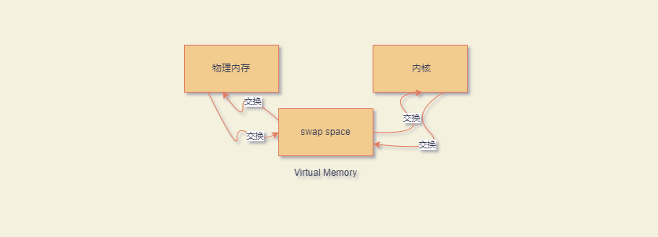
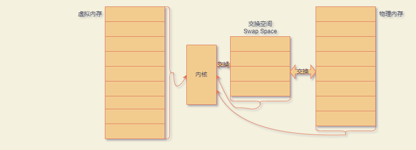
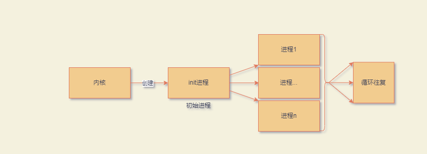
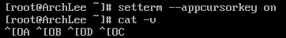
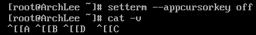

# Linux Shell

***

## 1.认识Linux Shell

### 1.1Linux系统

Linux系统可以划为四个部分：

- Linux内核

- GUN工具

- 图形化桌面环境

- 应用软件

#### 1.1.1Linux内核

Linux内核主要负责以下四种功能：

- 系统内存管理

- 软件程序管理

- 硬件设备管理

- 文件系统管理

##### 1 系统内存管理

内核可以管理服务器上的可用物理内存，还可以创建并管理虚拟内存（实际并不存在的内存）

**虚拟内存**

虚拟内存实际上并不存在

内存通过硬盘上称为交换空间（swap space）的存储区域来实现虚拟内存

内核在交换空间和实际物理内存之间反复交换虚拟内存中的内容，这使得系统以为自己拥有比物理内存更多的可用内容



a.物理内存与交换空间内存交换速率 `>` 实际物理内存大小

b.内核与交换空间内存交换速率 `>`实际内存大小

c.内核与交换控价内存交换速率 `==`物理内存与交换控价内存交换速率

如果a,b,c,三个条件成立，则：

系统会认为虚拟内存存储容量要远远大于物理内存

**内存映射**

内核将物理内存映射为虚拟内存




**内存**

内存被划分为若干块，这些块被称作页面（page）

- 内核会将每个内存页面置于物理内存或交换空间中

- 内核会维护一张内存页面表，指明哪些页面位于物理内存，哪些页面被交换到了磁盘

- 内核回归记录哪些内存页面正在使用总，自动把一段时间未访问的内存页面复制到交换空间区域（该过程称为换出：swapping out）


**页面表**

指明哪些页面位于物理内存，哪些页面被交换到了磁盘

**访问内存页面**

程序需要访问一个已被换出的内存页面时，内核必须将物理内存中的另一个页面换出来，为其腾出空间，然后从交换空间换入（swapping in）所请求的页面

##### 2 软件程序管理

Linux操作系统称运行中的程序为进程

- 进程可以在前台运行，将输出显示在屏幕上

- 进程可以在后台运行，隐藏到幕后

  内核控制者Linux系统如何管理运行在系统中的所有进程

  内核创建了第一个进程（称为init进程）来启动系统中所有其他进程

  **内核启动**

  - 当内核启动时，它会将`init`进程载入虚拟内存
  - 内核在启动其他进程时，会在虚拟内存中给新进程分配一块专有区域来存储该进程用到的数据和代码

    

    

**init进程实现**

a. SysVinit

基于Unix System V 初始化方法

SysVinit初始化方法使用运行级（runlevel）的概念来决定启动哪个程序

运行级定义了Linux系统的运行状态以及每种状态下应该运行的进程

| 运行级 |           描述           |
| :----: | :----------------------: |
|   0    |         关闭系统         |
|   1    | 单用户模式，用于系统维护 |
|   2    |  多用户模式，无联网服务  |
|   3    |  多用户模式，有联网服务  |
|   4    |          自定义          |
|   5    |   配有GUI的多用户模式    |
|   6    |         重启系统         |


​	`/etc/inittav`文件定义了系统的默认运行级

​	`/etc/rc.d`目录下的各个子目录中定义了特定运行机下启动的进程

​	可以使用`runlevel`命令随时查看当前运行级


​	b. systemd

​	诞生于2010年，现已经称为Linux发行版中最流行的初始化和进程管理系统

​	systemd初始化方法得以流行起来的原因在于能够根据不同的事件启动进程

 1. 系统启动时

 2. 链接到啊特定硬件设备时

 3. 服务启动时

 4. 建立好网络连接时

 5. 计时器到期时

systemd方法通过将事件与`单元文件（unit file）`链接来决定运行哪些进程

每个单元文件定义了特定事件发生时要启动的程序

`systemctl`程序允许启动、停止和列出系统中当前运行的单元文件

systemd方法将单元文件划归为`目标（target）`

目标定义了Linux系统的特定运行状态

在系统启动时，default.target单元定义了要启动的所有单元文件

```
# 可以通过systemctl命令查看当前默认目标

system get-default
graphical.target

graphical.target单元文件定义了多用户图形环境运行时要启动的进程，类似于旧的sysVinit运行级5
```

#####  3  硬件设备管理

内核的另一职责是管理硬件

任何需要与Linux系统进行通信的设备，都必须在Linux系统内核代码中加入该设备的驱动程序

驱动程序允许内核与设备之间交换数据

Linux内核中插入设备驱动的方法有两种

- 将驱动程序编译入内核

- 将设备驱动模块加入内核

**内核模块**

允许在无需重新编译内核的情况下将驱动程序插入运行中的内核，当设备不再使用时也可以将内核模块从内核中移走

**设备文件**

Linux系统将硬件设备视为`设备文件`,设备文件分为三种

- 字符设备文件
	
  每次只能处理一个字符的设备
	
- 块设备文件

  每次以块形式处理数据的设备

- 网络设备文件

  采用数据包发送和接收数据的设备

##### 4 文件系统管理

内核在编译时就加入对所有要用到的文件系统的支持

| 文件系统 |                      描 述                      |
| :------: | :---------------------------------------------: |
|   ext    |     Linux扩展文件系统，最早的Linux文件系统      |
|   ext2   | 第二扩展文件系统，在ext的基础上提供了更多的功能 |
|   ext3   |         第三扩展文件系统，支持日志功能          |
|   ext4   |       第四扩展文件系统，支持高级日志功能        |
|  btrfs   |  一种新的高性能文件系统，支持日志功能和大文件   |
|  exfat   |     扩展Windows文件系统，主要用于SD卡和U盘      |
|   hpfs   |               OS/2高性能文件系统                |
|   jfs    |                 IBM日志文件系统                 |
| iso9660  |                ISO 9660文件系统                 |
|  minix   |                  MINIX文件系统                  |
|  msdos   |                 Microsoft FAT16                 |
|   ncp    |                 Netware文件系统                 |
|   nfs    |                  网络文件系统                   |
|   ntfs   |            支持Microsoft NT文件系统             |
|   proc   |                  访问系统信息                   |
|   smb    |         用于网络访问的Samba SMB文件系统         |
|   sysv   |               早期的UNIX文件系统                |
|   ufs    |                   BSD文件系统                   |
|  umsdos  |         建立在msdos之上的类UNIX文件系统         |
|   vfat   |          Windows 95 文件系统（FAT32）           |
|   XFS    |             高性能64位日志文件系统              |

Linux服务器所访问的所有硬盘驱动器都必须采用上表所列文件系统类型中的一种进行格式化

Linux内核采用虚拟文件系统（Virtual File System，VFS）作为和各种文件系统交互的接口

#### 1.1.2GUN实用工具

GUN用于实现操作系统的各种标准功能

````
GUN（GUN代表GUN's Not Unix）组织开发出了一套完整的Unix实用工具，但是缺少用于支撑其运行的内核系统
````

```
Linux 内核和GUN操作系统实用公路结合在一起，产生了一款完整且功能丰富的自由操作系统
```

因此Linux系统指的是GUN实用工具与Linux内核的结合体，也被称为`GUN/Linux系统`

##### 1 核心GUN实用工具

`GUN项目`旨在为Unix系统管理员打造出一套可用的类Unix环境

Linux系统使用的这组核心工具被称为`coreutils（Core Utilities）`软件包

GUN `coreutils`软件包由3部分构成

- 文件实用工具

- 文本实用工具

- 进程实用工具

##### 2 Shell

GUN/Linux Shell是一种特殊的交互式工具，为用户提供了启动程序、管理文件系统中的文件、运行在Linux系统中的进程

Shell的核心是命令提示符，负责Shell的交互部分，允许用户输入文本命令，然后解释命令并在内核中执行

**Shell脚本**

将多个shell命令放入文件中作为程序执行

所有Linux发行版默认的Shell都是`bash Shell`

`bash Shell`由GUN项目开发，被作为标准Unix Shell（Bourne Shell，以其创建者得名）的替代品

bash Shell的名字是一个文字游戏：Bourne again Shell

##### 3  其他Shell

| Shell | 描述                                                         |
| ----- | ------------------------------------------------------------ |
| ash   | 一种简单的轻量级Shell，与Bourne Shell完全兼容                |
| korn  | 一种与Bourne Shell兼容的编程Shell                            |
| tcsh  | 一种将C语言中的一些元素引入Shell脚本中的Shell                |
| zsh   | 结合了bash、tcsh、korn的特性，提供高级编程特性、共享历史文件和主题化提示符的高级Shell |

#### 1.1.3Linux桌面环境

Linux桌面为操作人员提供了与Linux操作系统交互的入口，Linux初期，只有简单的Linux操作系统文本界面

- 图形化桌面

  顾名思义就是给操作系统添加图形，便于操作人员更直观的与操作系统交互

- X window

  ```
  视频环境由两个基本要素决定：显卡和显示器
  
  Linux软件需要具备显卡与显示器之间通信的方案，因此X Window软件是图形显示的核心部分
  
  X Window软件直接驱动显卡、显示器，属于底层程序，控制Linux应用程序如何在计算机上呈现窗口与图形
  
  最常永的两种X Window软件包：X.org和Wayland
  ```
  
  ```
  底层逻辑
  
  X.org基于Unix X Window System版本11
  
  X Window软件包会检测显卡和显示器，然后创建一个X Window配置文件
  
  X Window不具备用户操作文件或启动程序功能，仅仅能够生成图形化显示环境
  ```
  
- KDE Plasma桌面

  KDE（K desktop environment）于1996年作为开源项目发布，可以生成类似于MicroSoft Windows的图形化桌面环境

  ```
  KDE Plasma桌面允许在桌面的特定区域放置应用程序图标和文件图标
  单击应用程序图标，Linux系统会启动该应用程序
  单机文件图标，KDE桌面会尝试确定使用哪种应用程序来处理文件
  ```

  桌面底部横条成为面板（Panel），由四部分组成

  ```
  1. K菜单：包含了已安装应用程序的链接
  2. 程序快捷方式：是直接从面板启动应用程序的快速链接
  3. 任务栏：显示桌面当前正运行的应用程序的图标
  4. 小程序：会根据应用程序的状态变化而变化
  ```

- GNOME桌面

  GNOME（GUN network object model environment），即GUN网络对象模型环境

#### 1.1.4Linux发行版

完整的Linux包成为Linux发行版

Linux发行版分为两类：

- 完整的核心Linux发行版

  ```
  核心Linux发行版含有：内核、一个或多个图形化桌面环境、预编译好的大部分可用的Linux应用程序
  ```

  ```
  Linux早期，发行版是以多张软盘形式发布，整个发行版通常需要20张或更多的软盘
  当下，Linux发行版采用ISO镜像文件形式发布，ISO镜像是一个包含了完整的DVD镜像文件，可以使用软件将其刻录成DVD，或者创建可引导的U盘。
  只需要从DVD或U盘引导计算机即可安装Linux
  ```

- 特定用途的Linux发行版

  ```
  特定用途的Linux发行版通常基于某个主流发行版，但仅包含其中一部分用于特定用途的应用程序
  定制化发行版还尝试通过自动检测和自动配置常见硬件来帮助新手安装
  ```

### 2.Shell

Linux早期，系统管理员、程序员、系统用户都依赖Linux控制台终端，输入Shell命令查看文本输出

#### 2.1进入命令行

命令行界面（command line interface，CLI）、，CLI只允许输入文本，而且只能显示文本和基本图形输出

```
输出设备
只需要一个哑终端就能和Unxi系统交互
哑终端（dumb terminal）是由通信电缆（通常是多线束串行电缆，也叫带状电缆）连接到Unix系统的显示器和键盘
通过这种组合，可以向Unix系统输入文本数据并显示文本结果
```

#### 2.1.1控制台终端

通过Linux系统的文本模式进入CLI

```
该模式只在显示器上提供一个简单的Shell CLI，称为Linux控制台
Linux系统启动时，会自动创建多个虚拟控制台
```
虚拟控制台是运行在Linux系统内存中的终端会话

#### 2.1.2 图形化终端

由Linux图形化桌面环境中的终端仿真软件包所提供的终端仿真器

```
图形化终端仿真只负责Linux图形化体验的一部分
完整的体验需要借助包括图形化终端仿真软件（客户端）在内的多个组件来实现
```

Linux图形化桌面环境中的组件

| 名称       | 示例                                   | 描述                                     |
| ---------- | -------------------------------------- | ---------------------------------------- |
| 客户端     | 图形化终端仿真器，桌面环境，网络浏览器 | 请求图形化服务的程序                     |
| 显示服务器 | Watland、X Window System               | 管理显示和输入设备                       |
| 窗口管理器 | Mutter、Metacity、Kwin                 | 为窗口添加边框并提供窗口移动和功能的元素 |
| 小部件库   | Plasmoids、Cinnamon、Spics             | 为桌面环境客户端添加菜单和外观项的元素   |

图形化终端仿真器是图形化用户界面中（in the GUI）的CLI终端

虚拟控制台终端是图形化用户界面之外（outside the GUI）的CLI终端

#### 2.1.3Linux虚拟控制台

Linux在引导时会创建多个虚拟控制台，即`teletypewriter`（`tty`）

`teletypewriter`表示`电传打字机`

##### 1 切换虚拟控制台的作用

```
会话或程序卡住时，可以切换到另一个虚拟控制台继续对计算机进行操作

多任务操作：可以在多个控制台上进行不同的任务，它们之间互不影响

多用户同时登录：不同用户可以在不同虚拟控制台上各自登录
```

##### 2 切换操作

通过`chvt`命令切换

```
chvt + N

#change foreground virtual terminal	//切换虚拟控制台
#N表示第N个虚拟控制台
```

通过快捷键切换

```
Ctrl + Alt + /F1~F6/

#Ctrl + Alt + F7用于返回图形界面
```

##### 3 查看虚拟控制台信息

查看当前活动的虚拟控制台编号

```
fgconsole

#输出的数字表示tty编号
#foreground console		//当前控制台
```

查看当前终端设备路径

```
tty

#teletypewriter
```

### 2.1.4虚拟控制台外观

通过`setterm`命令可以设置Linux虚拟控制台的外观

##### 1 setterm命令

`setterm`用于设置Linux终端属性，属于`util-linux`包

`setterm`完整命令选项来自`util-Linux`包的`man page`，不同版本会存在差异

**--appcursorkey**

*全称*：`DEC Cursor Key Mode`

*作用*：改变方向键发送给程序的转义序列格式

*功能*：

```
setterm --appcursorkey on 		//开启应用模式


#开启应用模式后，⬆️ ⬇️ ⬅️ ➡️的转义序列格式对应关系为：
		⬆️：^[OA
		⬇️：^[OB
		⬅️：^[OD
		➡️：^[OC
```



```
setterm --appcursorkey off		//关闭应用模式


#关闭应用模式后，⬆️ ⬇️ ⬅️ ➡️的转义序列格式对应关系为：
		⬆️：^[[A
		⬇️：^[[B
		⬅️：^[[D
		➡️：^[[C
#关闭应用模式，此时为普通模式
```



*应用模式*

即DEC光标键应用模式，英文名称为`DECCKM`

设计思想

```
令统一套键盘在不同程序中发送不同的编码，从而兼容普通文本输入和全屏应用控制两种场景

方向键、功能键、数字小键盘等特殊按键没有现成的ASCII码，必须使用ESC开头的序列进行表示

ESC是ASCII中的Escape字符，八进制：033，十进制：27，十六进制：0x1B

ESC：转义字符，标志一个转义序列开始
CSI，全称：Control Sequence Introducer，控制序列引入符
```

控制序列

```
CSI ? 1 h		//开启光标模式
CSI ? 1 l		//关闭光标模式，回到普通模式
	
	
#CSI 就是ESC [，也常写作：\033[ 或 \e[
# ? 表示是DEC私有模式
# 1 表示模式编号
# h 表示set/enable，l 表示 reset/disable
```

作用：改变部分特殊键发送给程序的转义序列格式

一种终端键序列切换机制：

- 全屏程序用它获得更稳定的特殊键输入

- 普通命令行通常不需要它

**--background**

*作用*：将终端的背景色改为指定颜色

*参数*：

```
black		//黑色
red			//红色
green		//绿色
yellow		//黄色
blue		//蓝色
magenta		//紫红色
cyan		//浅蓝色
white		//白色
```

**--foreground**

*全称*：`fore ground`

*作用*：将终端的前景色（特别是文本）改为指定颜色

*参数*：

```
black		//黑色
red			//红色
green		//绿色
yellow		//黄色
blue		//蓝色
magenta		//紫红色
cyan		//浅蓝色
white		//白色
```

**--inverscreen**

*全称*：`DEC Screen Mode`

*作用*：交换背景色和前景色

*参数*：

```
on		//开启交换
off		//关闭交换
```

**--reset**

*作用*：将终端外观恢复成默认设置，并清屏

*参数*：无

**--store**

*作用*：

````
将终端当前的前景色和背景色设置成--reset选项的值

即将终端当前的前景色和背景色属性记录下来，当执行--reset选项时，终端会将-store选项记录的背景色和前景色属性设置为当前终端的背景色和前景色属性
````

*参数*：无

### 2.1.5图形化终端仿真器

在图形化环境下，通过图形化终端仿真器软件包来访问CLI

一些流行的图形化软件包：

- Alacritty
- cool-retro-term
- GNOME Terminal
- Guake
- Konsole
- kitty
-  rxvt-unicode
- Sakura
- st
- Terminator
- Terminology
- Termite
- Tilda
- xterm
- Cfce4-terminal
- Yakuake

不少Linux发行版会选择GNOME Terminal、Konsole、和xterm三者之一进行安装

##### 1 GNOME Terminal

GNOME Terminal是GNOME Shell桌面环境的默认终端仿真器。

*访问GNOME Terminal*

方法一：单击Terminal应用程序图标进行访问

方法二：设置快捷键访问GNOME Terminal

```
1. 访问Keyboard settings中的Keyboard Shortcuts
2. 滚动至底部找到+按钮
3. Name字段输入：GNOME Terminal
   Command字段输入：gnome-terminal
```

*菜单栏*

```
GNOME Terminal的菜单栏包含配置选项和定制学亚翔，可以通过这些选项打造符合自己使用习惯的GNOME Terminal

部分配置选项在Windows操作系统中也生效
```


File菜单下的配置选项

`名称`：New Tab 

`快捷键`：`Shift` +`Ctrl` +`T`

`描述`：在现有的GNOME Terminal窗口的新标签中启动有一个新的Shell会话

`操作效果`：


`名称`：New Window

`快捷键`：`Shift` +`Ctrl` + `N`

`描述`：在新的GNOME Terminal窗口中启动一个新的Shell会话

`操作效果`：


***

`名称`：Close Tab

`快捷键`：`Ctrl` + `Shift` +` W`

`描述`：在GNOME Terminal窗口中关闭当前标签

***

`名称`：Close Window	

`快捷键`：`Ctrl` + `Shift` +`Q`

`描述：关闭的昂钱GNOME Terminal窗口`

***

Edit菜单项

`名称`：Copy

`快捷键`：`Shift` +` Ctrl` + `C`

`描述`：将所选文本复制到GNOME Terminal的剪贴板中

***

`名称`：Copy as HTML

`快捷键`：`None（无）`

`描述`：将所选文本及其字体颜色复制到GNOME Terminal剪贴板中

***

`名称`：Paste

`快捷键`：`Shift`+ `Ctrl `+ `V`

`描述`：将GNOME Terminal剪贴板中的文本粘贴复制到会话中

***

`名称`：Select All

`快捷键`：`None（无）`

`描述`：选中回滚缓冲区（srollback buffer ）中的全部输出

***

`名称`：Preference

`快捷键`：`None（无）`

`描述`：编辑当前会话的配置文件

***

View菜单

`名称`：Shutdown Menbar

`快捷键`：`None（无）`

`描述`：打开/关闭菜单栏

***

`名称`：Full Screen

`快捷键`：`F11`

`描述`：打开/关闭终端窗口全桌面显示模式

***

`名称`：Zoom In

`快捷键`：`Ctrl` + `+`

`描述`：逐步增大窗口中的文本字号

***

`名称`：Normal Size

`快捷键`：`Ctrl` + `0`

`描述`：恢复默认字号

***

`名称`：Zoom Out

`快捷键`：`Ctrl` + `-`

`描述`：逐步减小窗口中的文本字号

Search菜单

`名称`：Find

`快捷键`：`Shift` + `Ctrl` + `F`

`描述`：打开Find窗口，指定待搜索的文本

***

`名称`：Find Next

`快捷键`：`Shift` + `Ctrl` + `G`

`描述`：从终端会话的当前位置开始向前搜索指定文本

***

`名称`：Find Previous

`快捷键`：`Shift` + `Ctrl` + `H`

`描述`：从终端会话的当前位置开始向后搜索指定文本

***

`名称`：Clear Highlight

`快捷键`：`` `` `Shift`  + `Ctrl`  + `J`

`描述`：去除已查找文本的高亮显示

Terminal菜单

`名称`：Read-Only

`描述`：允许/禁止终端会话接受键盘输入，该菜单项并不会影响快捷键

***

`名称`：Reset

`描述`：发出重置终端会话控制码

***

`名称`：Reset and Clear

`描述`：发出重置终端会话控制码并清除终端会话显示

***

`名称`：80 * 24

`描述`：将当前终端窗口尺寸调整为`80列宽` * `24行高`

***

`名称`：80 * 43

`描述`：将当前终端窗口尺寸调整为`80列宽` * `43行高`

***

`名称`：132 * 24

`描述`：将当前终端窗口尺寸调整为`132列宽` * `24行高`

***

`名称`：130* 43

`描述`：将当前终端窗口尺寸调整为`130列宽` * `43行高`

Tabs菜单

`名称`：Previous Tab

`快捷键`：`Ctrl` + `Page Up`

`描述`：使上一个标签成为活动标签

***

`名称`：Next Tab

`快捷键`：`Ctrl` + `Page Down`

`描述`：使下一个标签成为活动标签

***

`名称`：Move Terminal Left

`快捷键`：`Shift` + `Ctrl` + `Page Up`

`描述`：将当前标签放在前一个标签之前

***

`名称`：Move Terminal Right

`快捷键`：`Shift`  + `Ctrl` + `Page Down`

`描述`：将标签放在前一个标签之后

***

`名称`：Detach Terminal

`快捷键`：`None（无）`

`描述`：删除选项卡并使用此选项卡会话启动一个新的GNOME终端窗口

##### 2 Konsole

KDE项目拥有自己的终端仿真软件包Konsole

Konsole具备基本的终端仿真特性

