# ArchLinux安装

***

## 1.安装准备

### 1.1环境准备

如果是在电脑中安装ArchLinux虚拟机，则需要准备以下软件包：

- VMWare虚拟机

- ArchLinux镜像

如果是在电脑中安装ArchLinux系统，则需要准备以下软件包：

- rufus
- ArchLinux镜像

### 1.2VMware虚拟机配置

#### 1.1.1创建一个虚拟机

点击`文件`，在弹出的选项卡中选择`新建虚拟机`

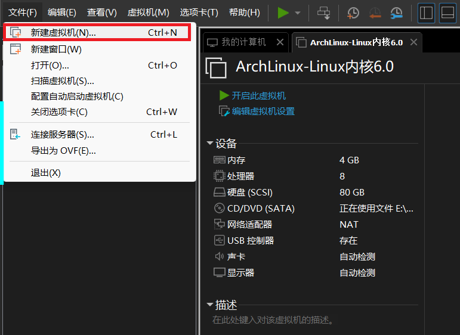

选择`自定义（高级）`，点击`下一步`

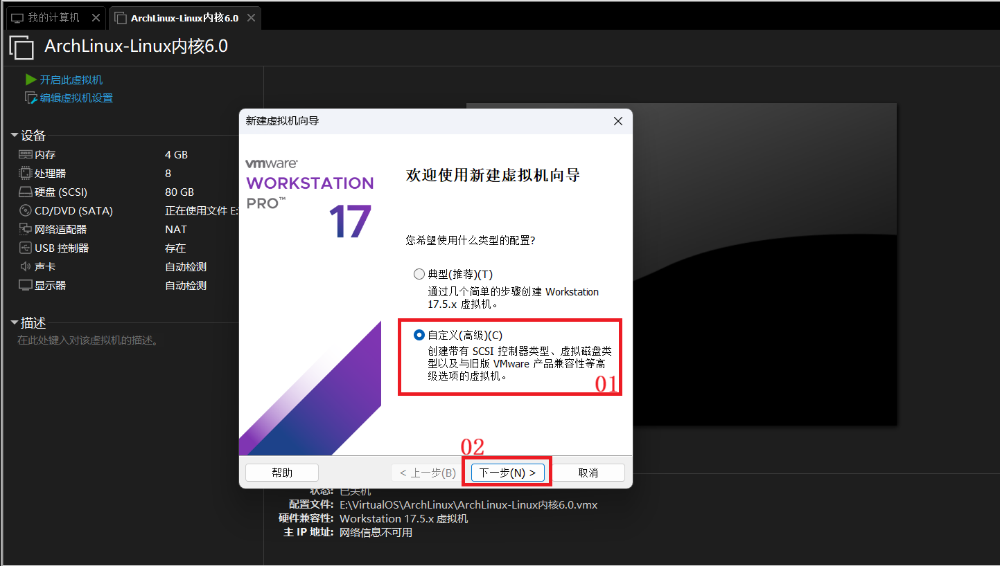

采用系统给定的默认`硬件兼容性`配置

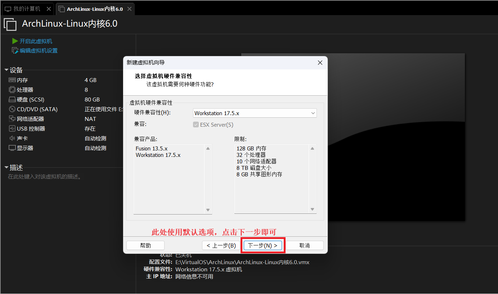

选择`安装程序光盘映像文件`，然后选择我们下好的ArchLinux镜像，配置完毕后，点击`下一步`

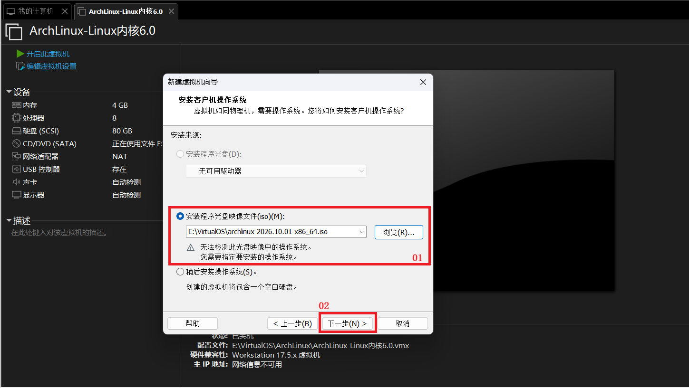

这里我们选择Linux作为`客户机操作系统`，Linux版本选择64位内核即可，建议选择5.0以上版本内核

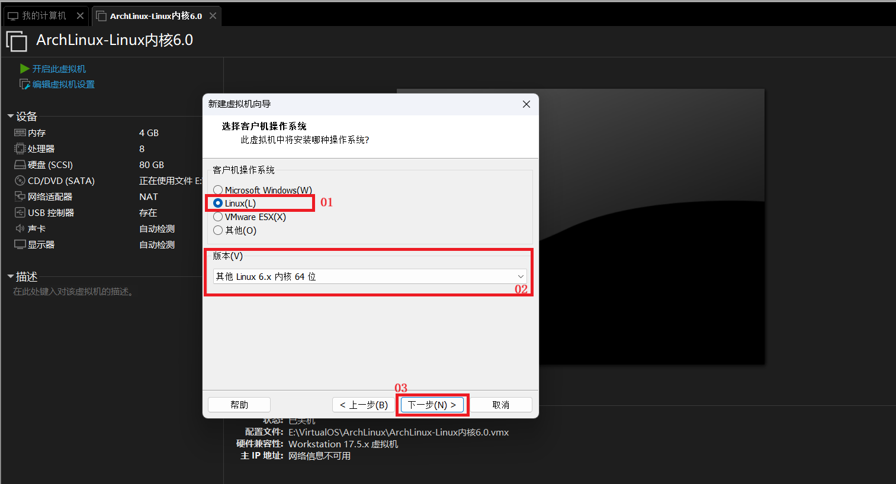

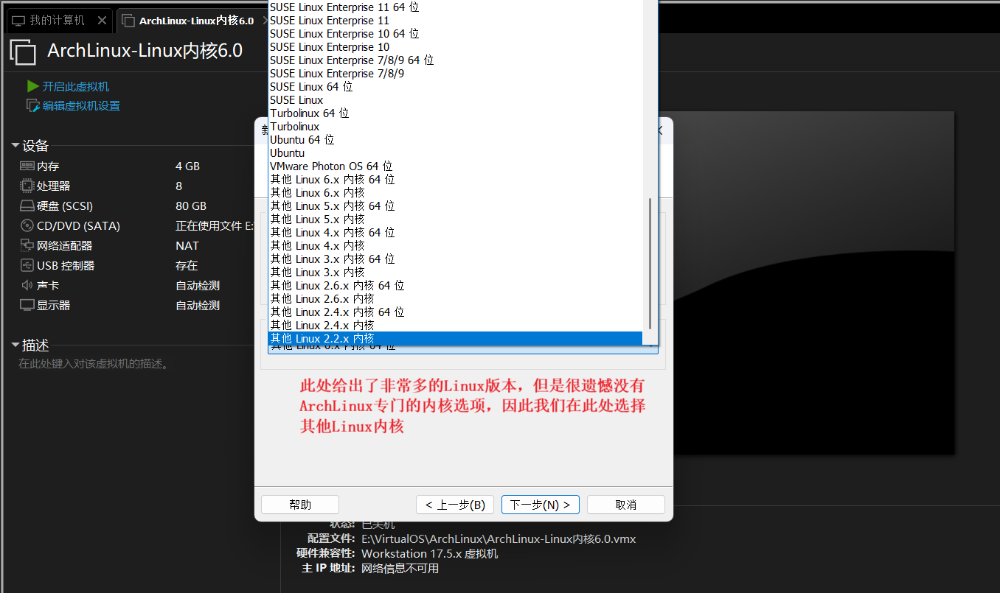

`虚拟机名称`是我们此次创建虚拟机的名字。例如：你将`虚拟机名称`设置为*ArchLinux*，那么我们本次创建的虚拟机就叫做*ArchLinux*

`位置`是本次创建虚拟机所产生的文件存放的位置，建议存放在自己熟悉的文件夹路径

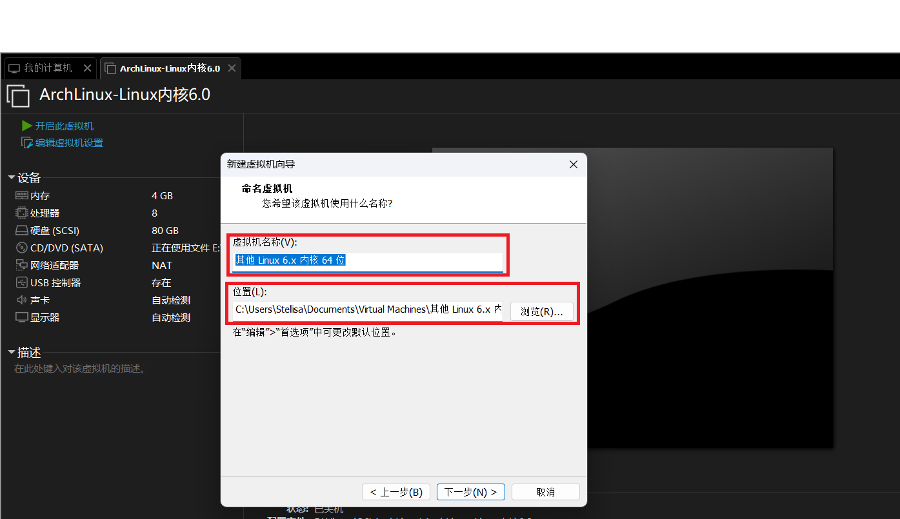

我们需要指定虚拟机处理器的数量。

虚拟机处理器的数量乘以内核数就是总的处理器内核总数。

处理器内核总数越多，虚拟机性能越好。

我们可以根据自身电脑配置对虚拟机内核数进行选择。

VMWare不支持超过电脑处理器内核总数的虚拟机。

我这台机器最多支持32核，因此可以选择`4（处理器数量）  `   *  `2（每个处理器的内核数量）`

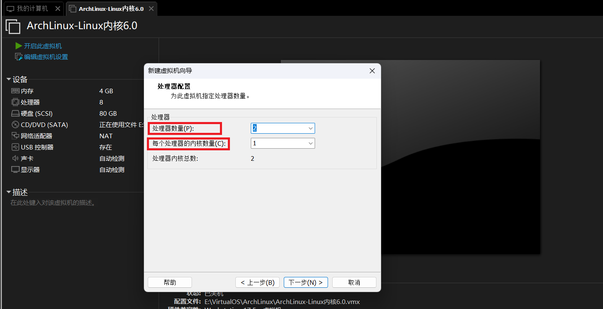

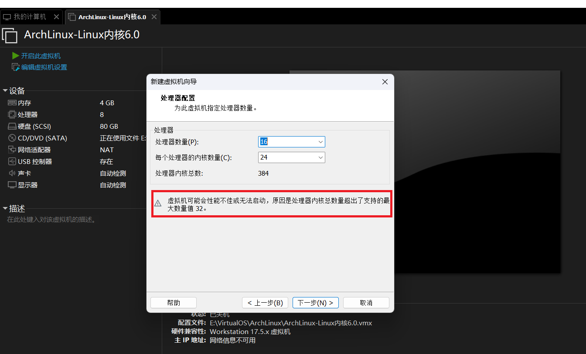

虚拟机内存可以根据自身电脑实际配置来设置，本电脑内存为`8*2=16GB`，因此选择将虚拟机内存设置为`4GB`

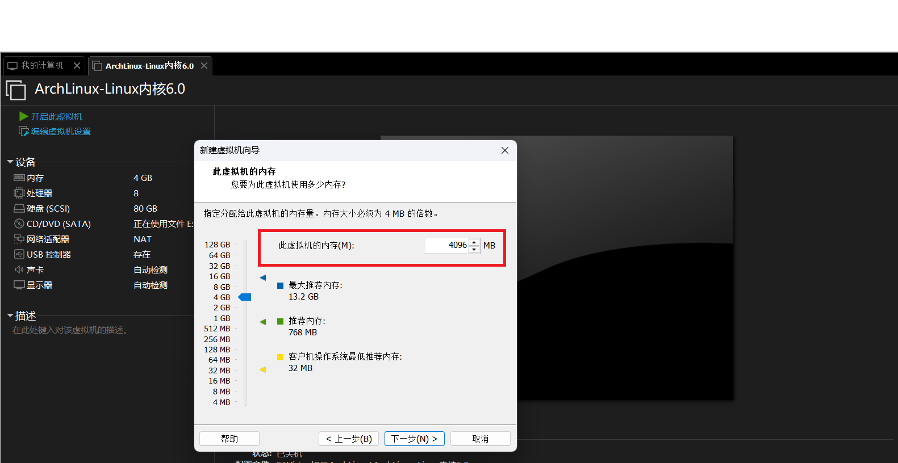

虚拟机类型采用`网络地址转化(NAT)`

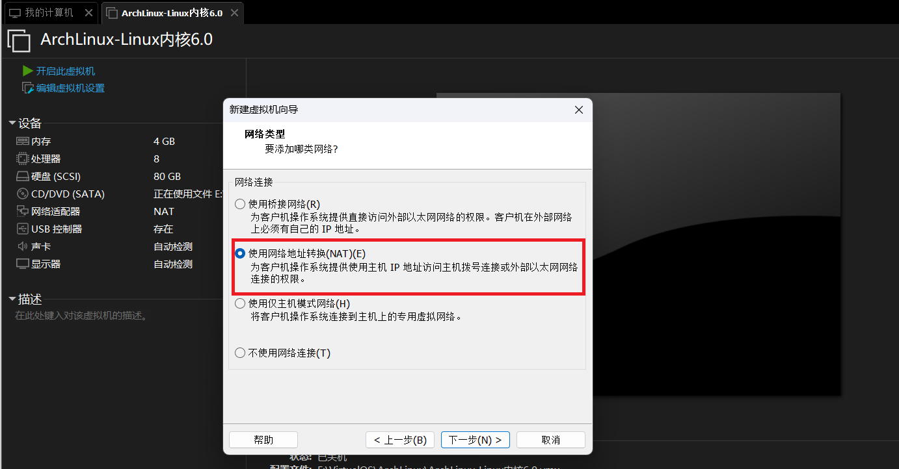

设置好虚拟机网络模式后，在装系统时使用`ping`或`curl`命令测试网络连接发现不通，这时我们需要检查虚拟机网络服务是否全部开启

按下键盘上的`Win + R`，在弹出的对话框中输入`service.msc`，点击`确定`后，系统会跳转到`服务(本地)`页面

需要检查一下三个服务是否全部开启，如果以下三个服务任意一个处于未运行状态，则会导致虚拟机无网络连接

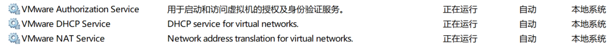

后续虚拟机配置都可以采用推荐配置

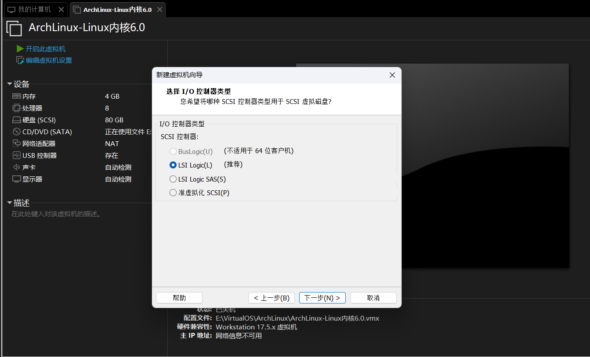

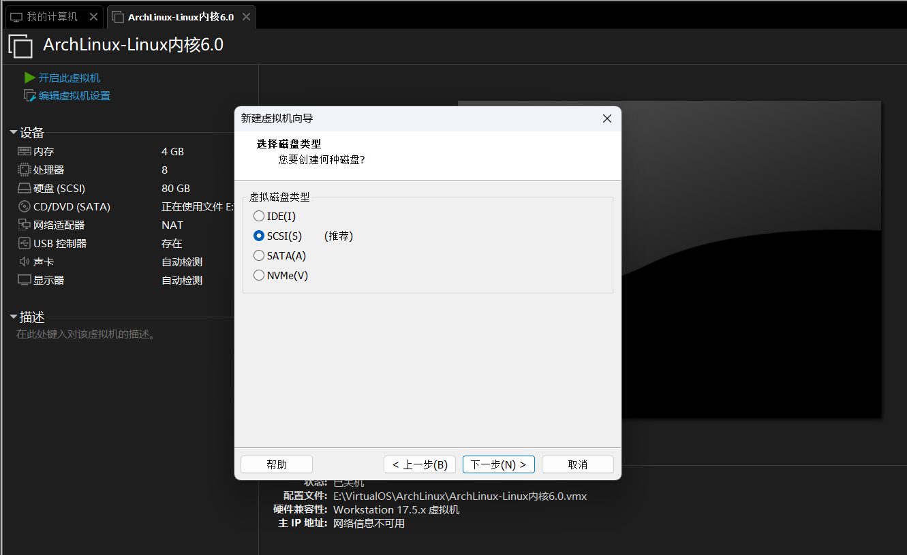

这里我们选择创建新虚拟磁盘

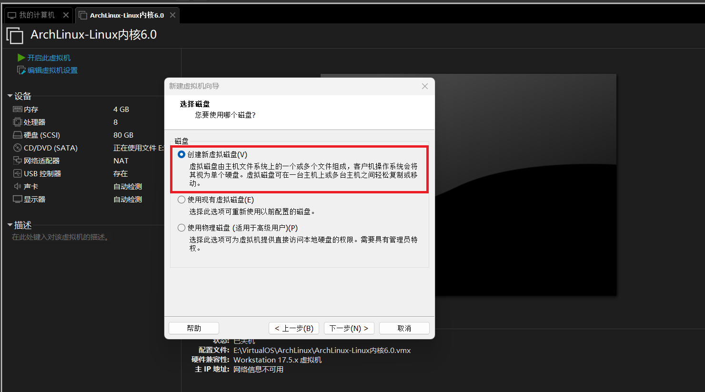

选定虚拟机硬盘空间大小

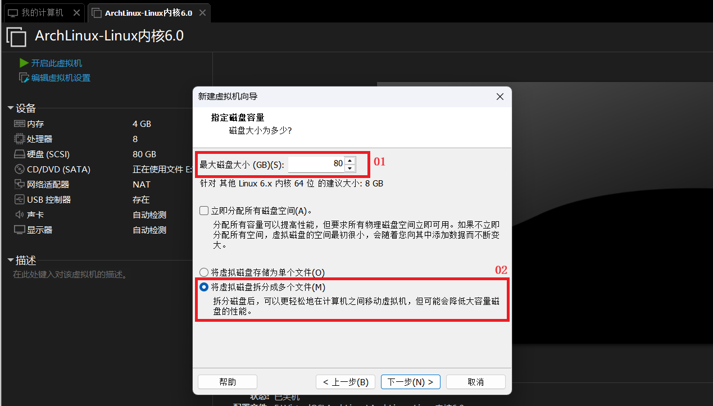

将创建虚拟磁盘的文件存放在自己熟悉的文件路径

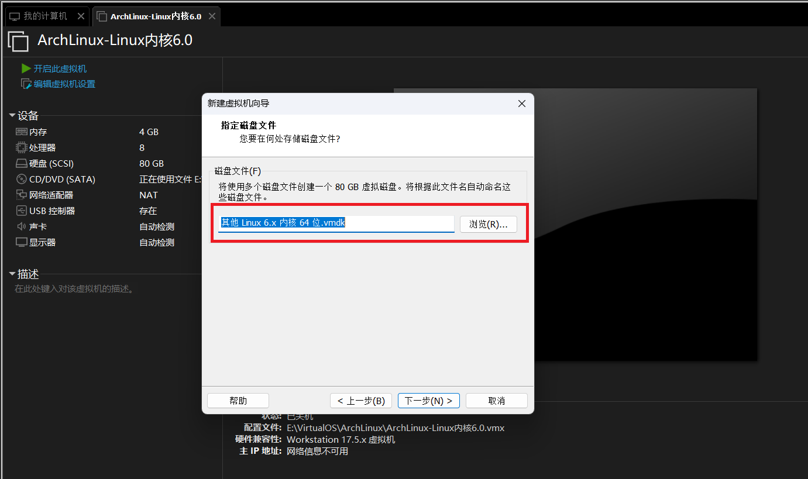

下图就是我们配置好的虚拟机

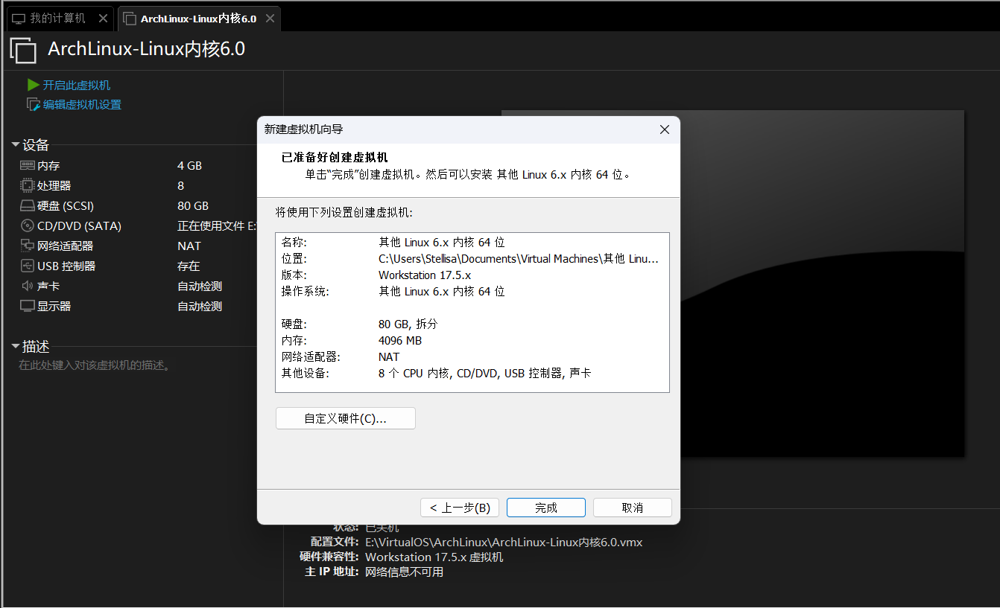

#### 1.1.2 设置efi启动

