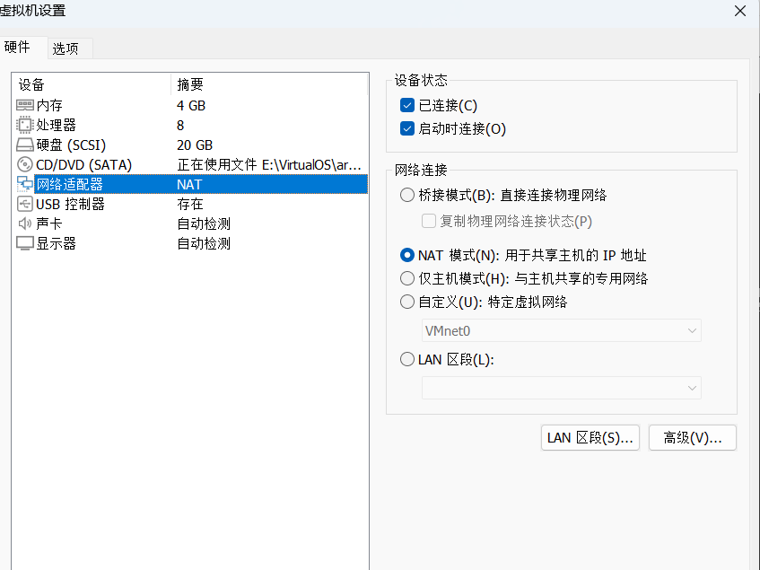
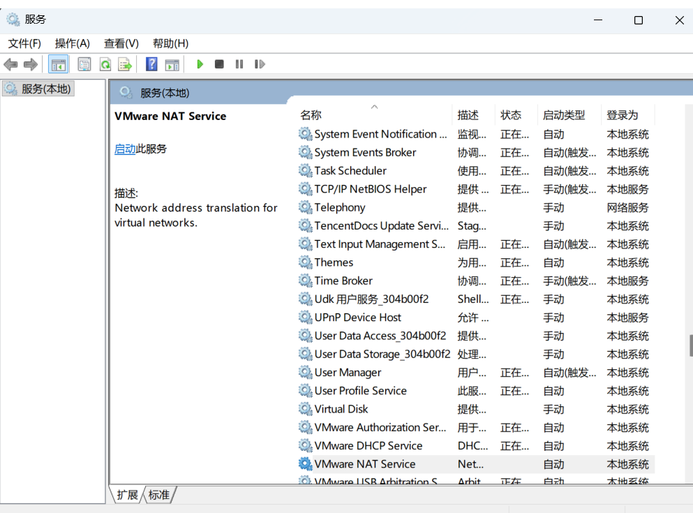
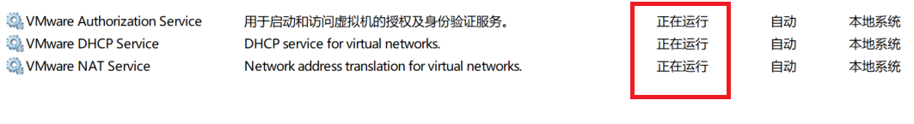
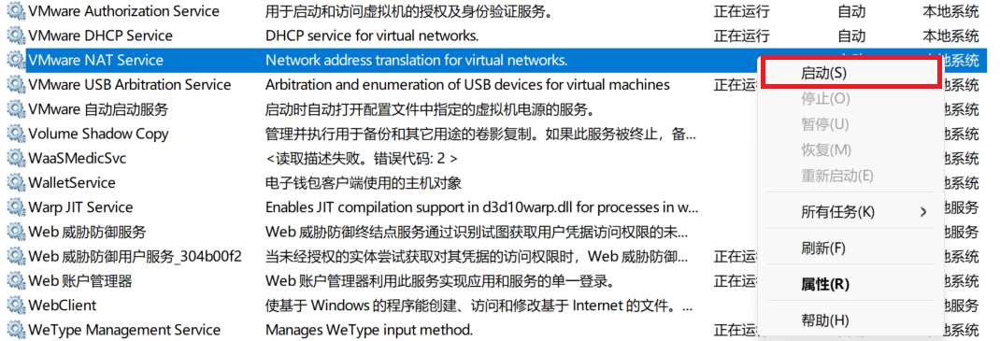

# ArchLinux安装

***

## 1 虚拟机无网络

### 1.1.1 网络连接模式

安装虚拟操作系统时，虚拟机应采用NAT模式来为虚拟操作系统配置网络

无论安装Linux系统还是Windows系统，都采用此网络连接模式

 

### 1.1.2 网络连通状态

安装操作系统时，实用`ping`命令来测试是否有网络连接

下图是无网络连接时，`ping`命令返回的结果

下图是有网络连接时，`ping`命令返回的结果

### 1.1.3 解决措施

按下`Win + R`，调出运行面板，输入`services.msc`进入本地服务管理页面

查看一下三个本地服务是否启动

`VMWare Authorization Service`

`VMWare NAT Service`

`VMWare DHCP Service`

这三个服务必须处于**正在运行**状态，如果某一服务不是该状态，请手动启动它

启动方法如下：

右键该服务，在弹出的选项窗口点击**启动**即可

